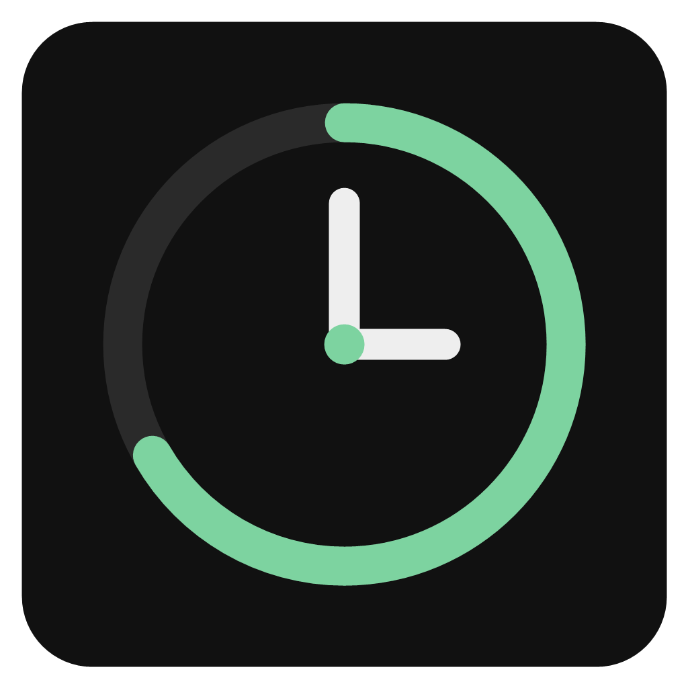
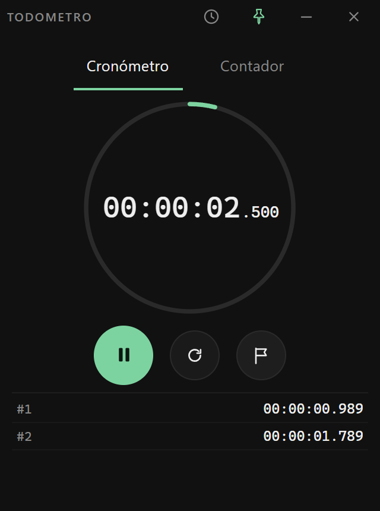
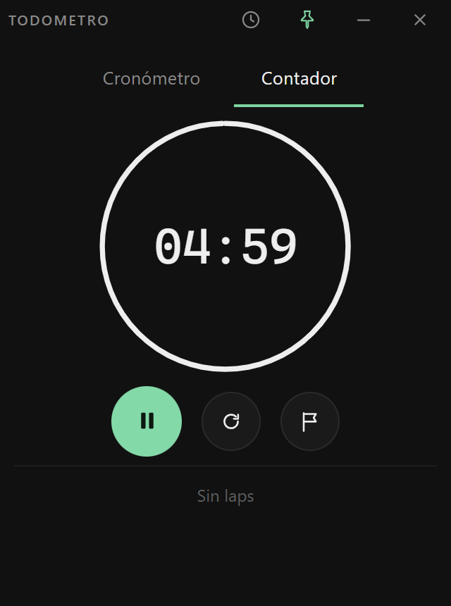
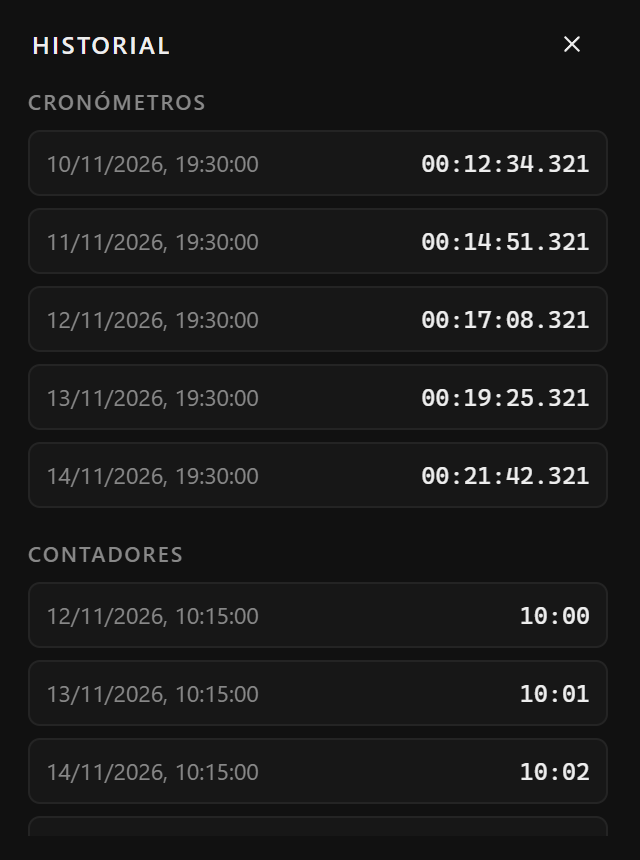
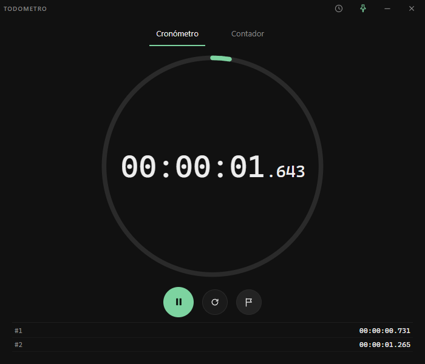

# TODOmetro

<p align="center">
  
</p>

<p align="center">
  Cronómetro y contador regresivo de escritorio, minimalista y sin distracciones.
</p>

<p align="center">
  <a href="https://github.com/tprxd07/todometro/releases/latest"></a>
  <a href="https://github.com/tprxd07/todometro/releases"></a>
  
</p>

**Versión actual: 1.0.0** (18/11/2026)

TODOmetro reúne en una única ventana dos formas de medir el tiempo: un
cronómetro ascendente con banderas y un contador descendente configurable con
laps. La ventana se puede redimensionar, se adapta desde 300 × 360 hasta
cualquier tamaño mayor y guarda el historial de las últimas sesiones en el
propio equipo, sin cuentas ni conexión a internet.

<p align="center">
  
  
</p>

## Índice

- [Qué hace](#qué-hace)
- [Descarga](#descarga)
- [Instalación por plataforma](#instalación-por-plataforma)
- [Uso](#uso)
- [Comportamiento y límites](#comportamiento-y-límites)
- [Desarrollo](#desarrollo)
- [Pruebas](#pruebas)
- [Releases y CI](#releases-y-ci)
- [Versión](#versión)
- [Limitaciones conocidas](#limitaciones-conocidas)
- [Licencia](#licencia)

## Qué hace

- **Cronómetro**: tiempo ascendente con horas, minutos, segundos y milésimas.
  Permite añadir banderas sin detener la marcha y archiva la sesión al reiniciar.
- **Contador**: duración configurable de 00:01 a 99:59. Al llegar a 00:00 el
  anillo se completa en color acento y parpadea dos veces. Los laps reinician el
  ciclo completo sin pausar el contador.
- **Historial local**: guarda las 5 últimas sesiones de cada modo, con fecha,
  total y detalle de banderas o laps. El detalle se puede desplegar.
- **Persistencia**: recuerda el último modo, la última duración y el historial.
  La sesión en curso se descarta al cerrar la app.
- **Ventana compacta y redimensionable**: 320 × 430 por defecto, mínimo
  300 × 360. Se puede arrastrar cualquier borde o esquina y el dial, la tipografía
  y los controles se adaptan al tamaño.
- **Siempre visible por defecto**: el pin de la barra superior alterna
  `alwaysOnTop` y muestra el estado en color acento.
- **Barra propia sin bordes**: arrastrar, fijar, minimizar, cerrar e historial.
  Los botones tienen 40 × 40 px de área de contacto.
- **Atajos de teclado**: Espacio, F, R y Esc.
- **Sin telemetría**: todo se guarda en `localStorage`; la app no hace peticiones
  de red.

<p align="center">
  
  
</p>

## Descarga

Las descargas directas siempre apuntan a la última release publicada. Todos los
archivos están también disponibles en la
[página de releases](https://github.com/tprxd07/todometro/releases).

| Plataforma | Formato | Descarga directa | Notas |
| --- | --- | --- | --- |
| Windows | Instalador NSIS | [TODOmetro-Windows-x64-Setup.exe](https://github.com/tprxd07/todometro/releases/latest/download/TODOmetro-Windows-x64-Setup.exe) | Recomendado. Crea acceso directo en el escritorio y en el menú Inicio. |
| Windows | Instalador MSI | [TODOmetro-Windows-x64.msi](https://github.com/tprxd07/todometro/releases/latest/download/TODOmetro-Windows-x64.msi) | Alternativa para instalación/despliegue. Crea entrada en el menú Inicio. |
| Linux | AppImage | [TODOmetro-Linux-x86_64.AppImage](https://github.com/tprxd07/todometro/releases/latest/download/TODOmetro-Linux-x86_64.AppImage) | Funciona en Arch, Ubuntu, Fedora, Debian y otras. |
| Linux | Debian/Ubuntu | [TODOmetro-Linux-amd64.deb](https://github.com/tprxd07/todometro/releases/latest/download/TODOmetro-Linux-amd64.deb) | Integra icono y entrada de aplicación. |
| Linux | Fedora/RHEL | [TODOmetro-Linux-x86_64.rpm](https://github.com/tprxd07/todometro/releases/latest/download/TODOmetro-Linux-x86_64.rpm) | Integra icono y entrada de aplicación. |
| macOS | Apple Silicon | [TODOmetro-macOS-arm64.dmg](https://github.com/tprxd07/todometro/releases/latest/download/TODOmetro-macOS-arm64.dmg) | Para M1, M2, M3, M4 y posteriores. |
| macOS | Intel | [TODOmetro-macOS-x64.dmg](https://github.com/tprxd07/todometro/releases/latest/download/TODOmetro-macOS-x64.dmg) | Para Mac con procesador Intel. |
| Todas | Checksums | [SHA256SUMS.txt](https://github.com/tprxd07/todometro/releases/latest/download/SHA256SUMS.txt) | Verifica la integridad de las descargas. |

> Los binarios no están firmados ni notarizados. Windows SmartScreen puede
> mostrar un aviso y macOS Gatekeeper puede bloquear la primera apertura. Las
> instrucciones para continuar están en cada apartado.

## Instalación por plataforma

### Windows

1. Descarga `TODOmetro-Windows-x64-Setup.exe` (recomendado) o el `.msi`.
2. Ejecuta el instalador. Si aparece SmartScreen: **Más información** →
   **Ejecutar de todas formas**.
3. El instalador NSIS crea el acceso directo **TODOmetro** en el escritorio y en
   el menú Inicio. El MSI crea la entrada del menú Inicio.
4. Abre TODOmetro desde el escritorio, el menú Inicio o el buscador de Windows.

Requiere Windows 10/11 con WebView2 (incluido en Windows actualizado; el
instalador puede descargarlo si falta).

### macOS

1. Descarga el `.dmg` correspondiente a tu Mac (Apple Silicon o Intel).
2. Abre el DMG y arrastra **TODOmetro** a la carpeta **Aplicaciones**.
3. Si Gatekeeper lo bloquea, haz clic derecho en la app → **Abrir**, o ejecuta:

   ```bash
   xattr -dr com.apple.quarantine /Applications/TODOmetro.app
   ```

4. La app aparece en Launchpad, Spotlight y el Finder. Si quieres un icono en el
   escritorio, crea un alias de `/Applications/TODOmetro.app`.

### Linux

#### AppImage (recomendado, también para Arch)

```bash
chmod +x TODOmetro-Linux-x86_64.AppImage
./TODOmetro-Linux-x86_64.AppImage
```

Si FUSE no está disponible:

```bash
./TODOmetro-Linux-x86_64.AppImage --appimage-extract-and-run
```

Para que aparezca con su icono en el menú/buscador de aplicaciones:

```bash
mkdir -p ~/.local/bin ~/.local/share/applications \
  ~/.local/share/icons/hicolor/256x256/apps
install -m755 TODOmetro-Linux-x86_64.AppImage ~/.local/bin/todometro
curl -L https://raw.githubusercontent.com/tprxd07/todometro/main/packaging/arch/todometro.desktop \
  -o ~/.local/share/applications/todometro.desktop
curl -L https://raw.githubusercontent.com/tprxd07/todometro/main/packaging/arch/todometro.png \
  -o ~/.local/share/icons/hicolor/256x256/apps/todometro.png
update-desktop-database ~/.local/share/applications
```

#### Debian / Ubuntu

```bash
sudo apt install ./TODOmetro-Linux-amd64.deb
```

#### Fedora / RHEL

```bash
sudo dnf install ./TODOmetro-Linux-x86_64.rpm
```

#### Arch Linux (paquete nativo)

El AppImage funciona directamente en Arch. Si prefieres un paquete instalado
con su entrada `.desktop` y su icono en el sistema:

```bash
git clone https://github.com/tprxd07/todometro.git
cd todometro/packaging/arch
makepkg -si
```

El `PKGBUILD` compila la app desde la release etiquetada y necesita `base-devel`,
`rust`, `nodejs`, `npm`, `webkit2gtk-4.1`, `gtk3`, `libappindicator-gtk3` y
`librsvg`. Tras instalarlo, TODOmetro aparece en el menú de aplicaciones y en el
buscador. Para un icono en el escritorio, arrastra la entrada desde el menú.

### Icono en escritorio y buscador

- **Windows NSIS**: acceso directo en el escritorio y en el menú Inicio.
- **Windows MSI**: entrada en el menú Inicio; el ejecutable también se puede
  anclar al escritorio manualmente.
- **Linux**: los paquetes `.deb`, `.rpm` y el `PKGBUILD` registran la entrada
  `.desktop` y el icono en el menú de aplicaciones. En AppImage, usa los comandos
  de integración anteriores.
- **macOS**: al copiar la app a `/Applications` aparece en Launchpad y Spotlight.

## Uso

### Modos

- **Cronómetro**: pulsa Iniciar, Añadir bandera para registrar parciales y
  Reiniciar para archivar la sesión. El anillo avanza con cada minuto.
- **Contador**: escribe minutos y segundos, pulsa Iniciar y usa Añadir lap para
  cerrar un ciclo y empezar otro con la duración completa. Al llegar a 00:00
  aparece el aviso visual y la sesión se archiva automáticamente.
- **Historial**: el botón de reloj de la barra superior abre las sesiones
  guardadas de ambos modos. Cada entrada se expande para ver sus banderas o laps.

### Ventana

- Arrastra la barra superior para moverla.
- Arrastra cualquier borde o esquina para redimensionarla. Tamaño mínimo:
  300 × 360; tamaño inicial: 320 × 430. No hay límite máximo práctico.
- El botón de pin alterna siempre visible.
- Minimizar y cerrar están en la barra superior.

### Atajos

| Tecla | Acción |
| --- | --- |
| `Espacio` | Iniciar, pausar o reanudar el modo activo |
| `F` | Añadir bandera (cronómetro) o lap (contador) |
| `R` | Reiniciar y archivar el modo activo |
| `Esc` | Cerrar el historial |

Los atajos se ignoran mientras el foco está en un campo de texto, al usar
Ctrl/Alt/Meta y mientras el historial está abierto.

## Comportamiento y límites

- **Duración por defecto del contador**: 05:00. Rango: 00:01 a 99:59. No se puede
  iniciar en 00:00; el campo se marca en rojo y no arranca.
- **Banderas**: solo se registran con tiempo transcurrido mayor que cero.
- **Laps**: solo se registran mientras el contador corre. Cada lap reinicia el
  ciclo con la duración completa. El total de la sesión suma todos los ciclos,
  por lo que puede superar la duración configurada.
- **Reset**: el cronómetro archiva si ha transcurrido tiempo. El contador archiva
  el tiempo consumido más los laps. El archivado automático al llegar a 00:00
  está protegido para no duplicar la entrada si después se pulsa reset.
- **Anillo**: el cronómetro usa acento de forma continua. El contador usa el color
  claro mientras corre, se completa en acento al terminar y parpadea dos veces.
- **Historial**: máximo 5 entradas por modo, la más reciente primero.
- **Persistencia**: se guarda en `localStorage` con la clave `todometro:v1`. Si
  existe la clave antigua `pomodoro:v1`, se lee como migración. Si el JSON está
  corrupto o `localStorage` falla, la app arranca con valores por defecto.
- **Sesión en curso**: no se guarda; al cerrar la app se descarta, pero el
  historial se conserva.
- **Privacidad**: no hay cuentas, red, analítica ni telemetría.

## Desarrollo

### Stack

- [Tauri v2](https://v2.tauri.app/) para la ventana y el empaquetado.
- HTML, CSS y JavaScript vanilla. Sin frameworks, sin bundler y sin TypeScript.
- `localStorage` para el estado.

### Estructura

```text
todometro/
  index.html                 Interfaz
  styles.css                 Estilos, layout adaptable y asas de redimensionado
  app.js                     Motor de tiempo, historial, atajos y ventana
  assets/todometro-icon.png  Icono fuente
  scripts/sync-frontend.mjs  Copia el frontend a dist/
  docs/screenshots/          Capturas para el README
  packaging/arch/            PKGBUILD, .desktop e icono para Arch Linux
  src-tauri/
    Cargo.toml
    build.rs
    tauri.conf.json
    capabilities/default.json
    icons/
    src/main.rs
  .github/workflows/release.yml
  README.md
  LICENSE
```

`dist/` se genera automáticamente con `scripts/sync-frontend.mjs` antes de
cualquier comando de Tauri. Copia `index.html`, `styles.css` y `app.js`; no
transforma ni compila nada.

### Requisitos

**Windows**

- Node.js 18 o superior y npm.
- Rust estable con [rustup](https://rustup.rs).
- Visual Studio Build Tools 2022 con **Desarrollo para el escritorio con C++**.
- WebView2.

**Linux**

- Node.js 18 o superior, Rust y las dependencias de Tauri/WebKitGTK:

  ```bash
  sudo apt install libwebkit2gtk-4.1-dev build-essential curl wget file \
    libxdo-dev libssl-dev libayatana-appindicator3-dev librsvg2-dev
  ```

**macOS**

- Node.js 18 o superior, Rust y Xcode Command Line Tools:

  ```bash
  xcode-select --install
  ```

### Comandos

```bash
npm install
npm run tauri dev     # desarrollo
npm run tauri build   # instaladores de la plataforma actual
```

Artefactos habituales:

- Windows: `src-tauri/target/release/bundle/msi/*.msi` y
  `src-tauri/target/release/bundle/nsis/*-setup.exe`.
- Linux: `src-tauri/target/release/bundle/{appimage,deb,rpm}/`.
- macOS: `src-tauri/target/release/bundle/dmg/*.dmg`.

El script `pretauri` copia el frontend a `dist/` antes de arrancar. No hay
servidor de desarrollo ni recarga automática; al cambiar el frontend, vuelve a
ejecutar `npm run tauri dev` o recarga la ventana.

## Pruebas

- Sintaxis de `app.js` y del script de copia con `node --check`.
- Pruebas de lógica con JSDOM: flujos de cronómetro y contador, banderas, laps,
  reset, archivado, límite de 5 + 5 entradas, persistencia, JSON corrupto,
  atajos y migración de la clave antigua.
- Render con Chromium headless a 300 × 360, 320 × 430, 500 × 700 y 900 × 800,
  comprobando que no hay desbordamiento ni errores de consola.
- Prueba con `npm run tauri dev`: ventana real 320 × 430, centrado, topmost,
  pin, minimizar/restaurar, cierre y estilo `WS_THICKFRAME`. Arrastrando los
  bordes se amplió, se redujo hasta el mínimo de 300 × 360 y se aumentó en alto,
  comprobando que el layout sigue siendo usable.
- `npm run tauri build` en Windows: MSI y NSIS generados y ejecutable release
  arrancado correctamente. Artefactos locales:
  `TODOmetro_1.0.0_x64_en-US.msi` y `TODOmetro_1.0.0_x64-setup.exe`.

## Releases y CI

El workflow [`.github/workflows/release.yml`](.github/workflows/release.yml)
compila Windows, Linux y macOS al publicar un tag `v*`. Después reúne los
artefactos, los renombra con nombres estables y crea la release con
`SHA256SUMS.txt`.

Para publicar una versión nueva:

```bash
git tag v1.0.0
git push origin v1.0.0
```

Los enlaces `releases/latest/download/...` del apartado de descarga apuntan a
esos nombres estables y siguen funcionando en versiones posteriores.

## Versión

**1.0.0** — 18/11/2026

- Cambio de nombre a TODOmetro e icono propio.
- Ventana redimensionable con mínimo 300 × 360 y layout adaptable.
- Cronómetro, contador, banderas, laps, historial y persistencia local.
- Instaladores y paquetes para Windows, Linux y macOS.
- Integración con escritorio, menú Inicio, menú de aplicaciones y Spotlight.

## Limitaciones conocidas

- Las builds no están firmadas: Windows SmartScreen y macOS Gatekeeper pueden
  mostrar avisos. No hay notarización de Apple ni certificado Authenticode.
- No hay sonido ni notificaciones del sistema; el aviso de fin es visual.
- El historial se limita a 5 sesiones por modo.
- La sesión en curso no sobrevive al cierre de la app.
- En Linux, el AppImage necesita FUSE o `--appimage-extract-and-run`.
- El paquete nativo de Arch se compila desde fuente y tarda lo que tarde Cargo.

## Licencia

MIT. Consulta [LICENSE](LICENSE).
